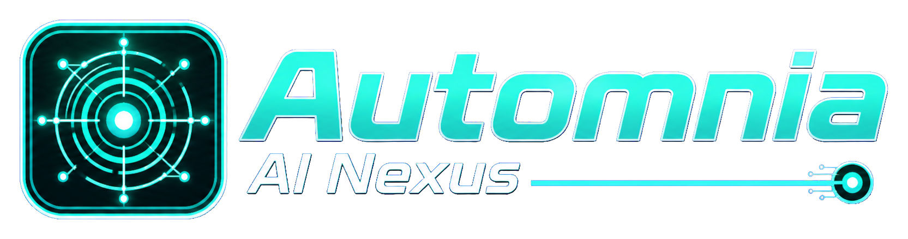
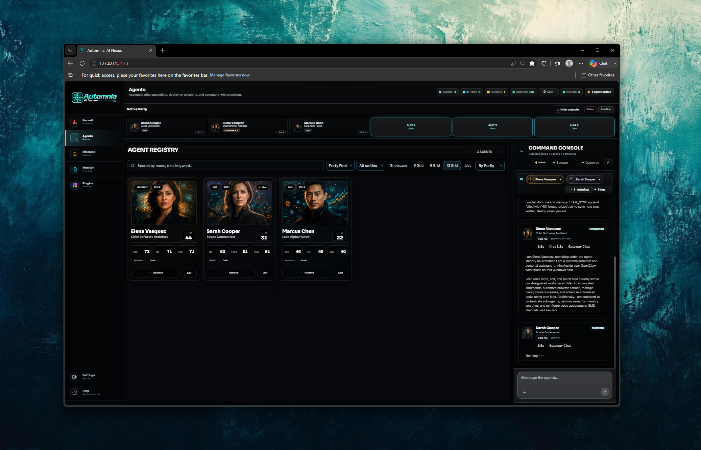
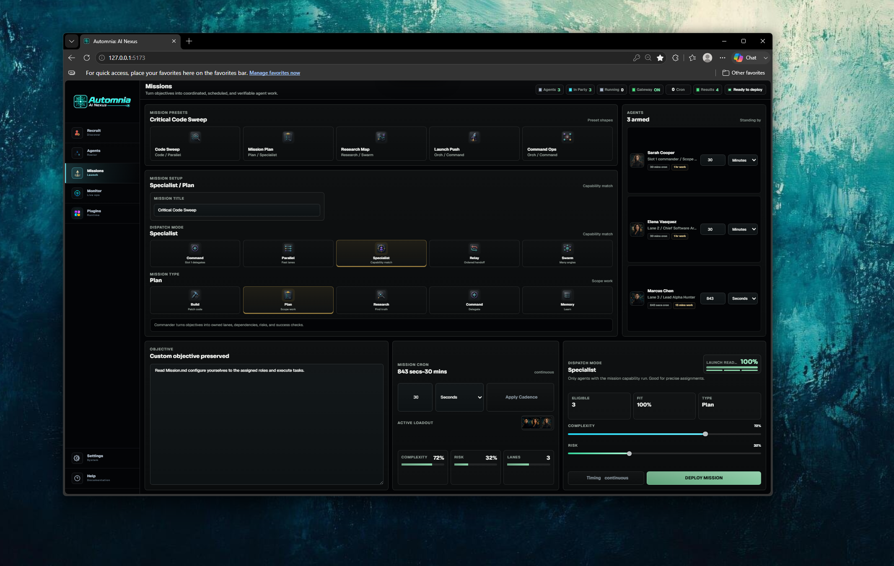
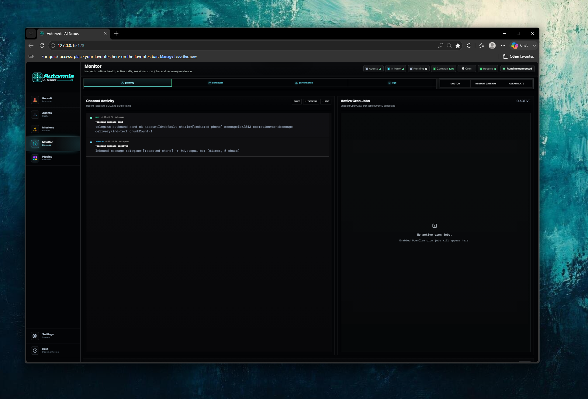
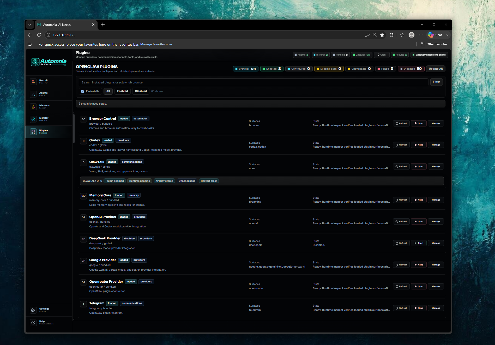
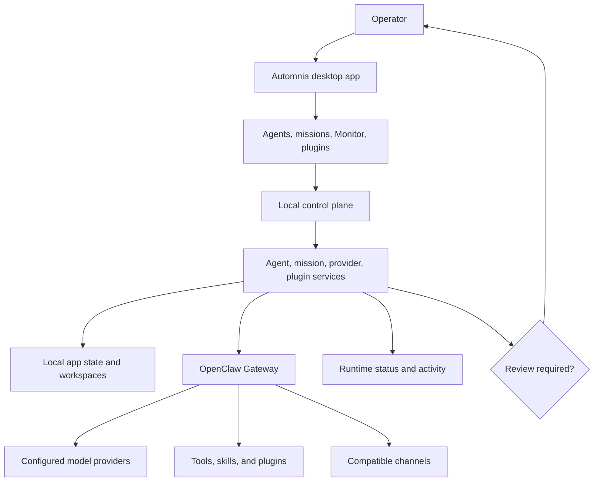

<div align="center">



# Automnia AI Nexus

### Your desktop command center for building, directing, and supervising AI agents.

Create one capable general agent or assemble a team of specialists. Give each agent a role, model, workspace, tools, and rules. Launch missions, schedule recurring work, and follow activity from a live operations view.

<p><a href="#run-automnia-from-source">Quick start</a> · <a href="#whats-new-in-1029">What’s new in 1.0.29</a> · <a href="docs/USER_GUIDE.md">User guide</a> · <a href="docs/BETA_SUPPORT.md">Support</a></p>

</div>



## AI work, with an operations layer

Automnia turns a chat with an AI into work you can shape and supervise. Start with one agent for everyday tasks. Add specialists when a job benefits from distinct roles, permissions, tools, or model routes. Use missions and schedules to make repeat work consistent, then use Monitor to see what ran, what is running, and what needs attention.

The desktop app and control plane run locally. Agents can use local or hosted model routes and connected services; what leaves the machine depends on the providers and integrations you configure. See [Data Handling](DATA_HANDLING.md).

## What you can do

| Capability | How it works |
| --- | --- |
| **Build your team** | Create a general agent, purpose-built specialists, or both. Set each agent’s identity, instructions, workspace, model route, and tools. |
| **Direct missions** | Break a larger objective into assigned work, acceptance criteria, schedules, and recovery steps. Run now, later, or on a recurring cadence. |
| **Connect your stack** | Extend agents with configured providers, skills, plugins, browser and filesystem tools, and compatible messaging channels. |
| **Stay in the loop** | Chat directly with an agent, watch activity in Monitor, and use review rules for actions that need your attention. |
| **Recover with context** | Inspect Gateway health, sessions, logs, scheduled jobs, errors, and recovery status in one workspace. |

### Example workflows

- **Software work:** delegate research, implementation, review, and validation across agents with scoped repository access.
- **Research:** compare sources, preserve useful context, and return a decision-ready brief.
- **Support and operations:** prepare customer replies, review store or business data, and route follow-ups through configured tools.
- **Content and monitoring:** plan campaigns or check selected signals on a schedule, with results returned for review.

What an agent can do depends on the selected model, connected tools, workspace access, and the rules you configure.

## What’s new in 1.0.29

**A more direct agent chat, smarter model recovery, and a steadier runtime.**

- Open an agent conversation full screen, with run and stop actions scoped to that conversation.
- Apply configured model fallback when Automnia Cloud returns HTTP 424.
- Make Codex health repair wait until Gateway startup settles, and protect a newer installed Codex plugin from replacement.
- Update the bundled OpenClaw runtime and Codex integration to 2026.11.6.

See the complete [1.0.29 changelog](CHANGELOG.md#1029---2026-11-20).

## Explore the workspace

<table>
  <tr>
    <td width="33%"></td>
    <td width="33%"></td>
    <td width="33%"></td>
  </tr>
  <tr>
    <td align="center"><strong>Mission Control</strong></td>
    <td align="center"><strong>Monitor</strong></td>
    <td align="center"><strong>Plugins</strong></td>
  </tr>
</table>

## Run Automnia from source

Recommended: Node.js 24. Node.js 22.19+ is supported for compatibility. You’ll also need npm and Git.

```bash
git clone https://github.com/hotboysupreme12-hash/Automnia-AI-Nexus.git
cd Automnia-AI-Nexus
npm ci
npm run prepare:openclaw-vendor
npm run desktop
```

For the live development server, run:

```bash
npm run dev
```

Packaged desktop targets include Windows x64, Intel and Apple silicon macOS, and Linux x86_64. Read [Installer Support](docs/INSTALLER_SUPPORT.md) for operating-system minimums, architecture details, and release caveats.

## How it fits together

<details>
<summary><strong>Architecture</strong></summary>



</details>

## Release validation

Run `npm run release:validate` to check a packaged release candidate, including its `distribution-signing.json` evidence when platform signing is required. When checksum-evidence signing is enabled, `npm run release:sign` can use `AUTOMNIA_RELEASE_SIGNING_PRIVATE_KEY_FILE` for the signing key. Public release signing rules and the version-specific unsigned exceptions are documented in [Release Governance](docs/RELEASE_GOVERNANCE.md).

Tagged customer releases ordinarily require Windows Authenticode and macOS Developer ID plus Apple notarization credentials. The guarded unsigned installer exceptions for v1.0.28 and v1.0.29 require their matching repository variables, `AUTOMNIA_ALLOW_UNSIGNED_V1_0_28=true` and `AUTOMNIA_ALLOW_UNSIGNED_V1_0_29=true`, and apply only to those tags. Both updater manifests remain signed; later releases require platform signing.

## Documentation

| If you want to… | Start here |
| --- | --- |
| Learn the main workflows | [User Guide](docs/USER_GUIDE.md) |
| Design agents and missions | [Assistant Operations Manual](docs/AUTOMNIA_ASSISTANT_OPERATIONS_MANUAL.md) |
| Browse the interface | [UI Reference](docs/AUTOMNIA_UI_REFERENCE.md) |
| Get help or send feedback | [Support Guide](docs/BETA_SUPPORT.md) |
| Check platform requirements | [Installer Support](docs/INSTALLER_SUPPORT.md) |
| Read version history | [Changelog](CHANGELOG.md) |
| Understand local and provider data boundaries | [Data Handling](DATA_HANDLING.md) |
| Report a security issue | [Security](SECURITY.md) |
| Review CI and release evidence | [CI Evidence](docs/CI_EVIDENCE.md) |
| Understand release controls | [Release Governance](docs/RELEASE_GOVERNANCE.md) |
| Deploy or migrate Automnia Cloud | [Google Cloud deployment package](infra/gcloud/README.md) |

<div align="center">

**Automnia AI Nexus** · Build the team. Direct the work. See what happened.

</div>
